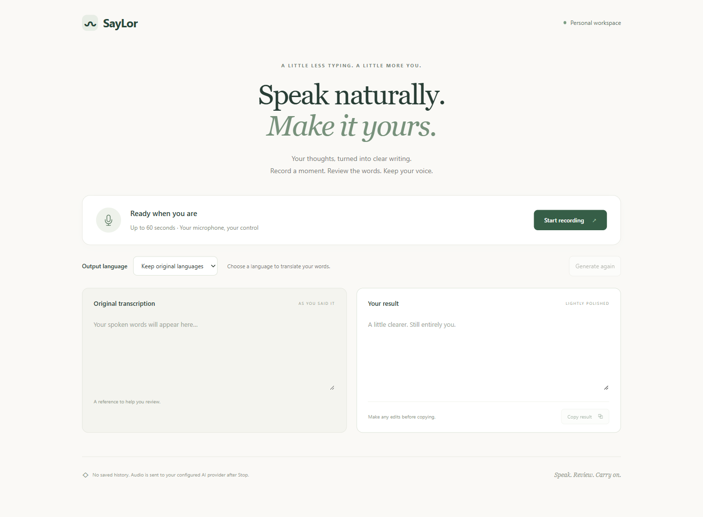
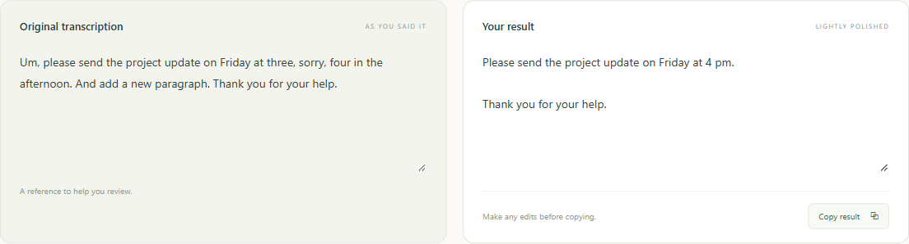
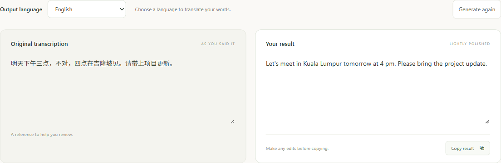

# SayLor

**Speak naturally. Turn your voice into clear writing.**

SayLor is a personal learning project for short dictation and translation, available as a web app and a portable Windows desktop app. It focuses on English, Mandarin, Malay and mixed-language speech.

[Try the web app](https://qw-saylor.vercel.app/) · [Windows desktop guide](docs/desktop.md) · [Hosting guide](docs/deployment.md)

## What it does

- Record up to 60 seconds, with a timer and Cancel control.
- Review the original transcription beside a lightly cleaned, editable result.
- Keep the original languages or translate into English, Simplified Chinese or Malay.
- Change the output language after recording to translate immediately, without recording again.
- Copy your edited result and retry a failed stage without repeating successful work.
- On Windows, dictate from another app using **Ctrl+Alt+Space** and automatically paste the result there.

For example, speak Chinese and choose **English** to get an English result. Cleanup aims to remove fillers and false starts while preserving your meaning. Review names, numbers and important wording before using the result.

## Screenshots

These screenshots use non-sensitive demo text and simulated AI responses to illustrate the interface, rather than measured speech accuracy.

### Recording workspace

Start a recording, choose an output language, and review your original words beside the result.



### Dictation and cleanup

Review the original transcription alongside a cleaner result, then edit or copy it. This example shows a corrected time and a dictated paragraph break.



### Chinese to English

Choose **English** after recording Chinese to translate the original transcription immediately, without recording again.



## Use the web app

Open [qw-saylor.vercel.app](https://qw-saylor.vercel.app/), allow microphone access when prompted, and select **Start recording**. Stop when finished, choose an output language, then review, edit and copy your result. Selecting another language translates the original transcription immediately; SayLor asks before replacing manual edits.

The hosted app is public and requires no login. It shares a limited free AI quota across visitors, so it may become temporarily unavailable. The recording allowance is 20 submissions per hour per running server instance, with bursts allowed. Restarts reset counters and separate instances have separate allowances; this is a best-effort limit. Translation has separate provider quota constraints.

## Use the Windows app

The Windows x64 app runs in the system tray. A portable build can be created from this repository using the instructions below; a GitHub release download is not published yet.

1. Open SayLor and choose your output language.
2. Return to the destination app and place your cursor in its text field.
3. Press **Ctrl+Alt+Space** to record, then press it again to stop.
4. After processing, SayLor pastes into the original app. It does not press Enter or send a message.

**Escape** cancels shortcut dictation. Closing the window cancels pending work and hides it to the tray; use the tray menu to quit or disable automatic paste. If focus changes or Windows blocks insertion, review and copy the retained result manually. Recording with the window button uses manual copy.

The app requires internet access and uses the hosted API. Its portable build is unsigned, has no automatic updater and needs no local API key. See the [desktop guide](docs/desktop.md) for details. Current product scope is **web and Windows desktop**; native mobile apps and PWAs are not planned.

## Privacy and project status

Audio and text are sent through the backend to Groq for processing. Hosted and desktop use also pass through Vercel. SayLor saves no recording or transcript history; useful text stays in the current session, and the output-language preference is stored locally. Provider and hosting metadata/retention policies are separate from the app's behavior.

API keys stay on the backend and must never be placed in browser or desktop assets. The app has no automatic paid fallback. Cloud services remain subject to their free-plan quotas and terms.

The owner has tested and accepted the Windows workflow for personal use. Automated checks cover the application workflow and failure handling; formal speech-quality acceptance was deferred for this practice project. This is not a guarantee of transcription accuracy or latency. See the [evaluation guide](docs/evaluation.md) for the maintained evaluation process.

## Run locally

Requirements: Node.js 24 and pnpm 12.8.1. On Windows, use `pnpm.cmd` if PowerShell blocks the `pnpm` shim.

```powershell
pnpm.cmd install --frozen-lockfile
Copy-Item .env.example .env # Only if .env does not already exist.
```

Set your own `GROQ_API_KEY` in the root `.env`. Use your intended free account/privacy settings and keep the key out of Git. Never use a `VITE_` variable for a provider key.

```powershell
pnpm.cmd dev
```

Open **http://127.0.0.1:5173** in Chrome or Edge. This starts the local web app and API; only AI processing requires the cloud provider.

## Build the Windows app

Build on Windows x64 with the Windows .NET Framework C# compiler available:

```powershell
pnpm.cmd --filter @saylor/desktop runtime:install
pnpm.cmd desktop:build
```

Open `SayLor.exe` in `apps/desktop/dist/releases/SayLor-win32-x64`. Keep the entire output folder together. The desktop build uses the hosted API and excludes the root `.env` and provider credentials. [Full build and verification instructions](docs/desktop.md).

## Development and verification

```powershell
pnpm.cmd exec playwright install chromium
pnpm.cmd check
```

The shared check runs tool tests, desktop controller/proxy tests, type checking, browser/API workflows, production build and credential scanning. Controlled providers and synthetic microphone fixtures avoid live AI requests. Windows-only desktop smoke and packaged-startup checks are documented in the desktop guide.

| Area | Stack / responsibility |
| --- | --- |
| Web | React, Vite and TypeScript; microphone capture, editing and translation controls |
| Desktop | Electron with a sandboxed renderer and a native Windows helper for guarded paste |
| API | Hono on Node.js; validation, quotas and Groq adapters |
| Hosting | Vercel Hobby frontend and Functions in one project |
| AI | Whisper Large V3 Turbo for transcription; GPT-OSS 120B for cleanup and translation |
| Workspace | pnpm; shared contracts in `packages/contracts` |

Backend operations are `POST /api/transcribe` for bounded mono 16 kHz PCM16 WAV and `POST /api/process` for cleanup/translation. Provider keys, orchestration and timeouts belong to the backend. See [deployment](docs/deployment.md), [evaluation](docs/evaluation.md) and [local operations](docs/agents/operations.md) for maintenance details.
